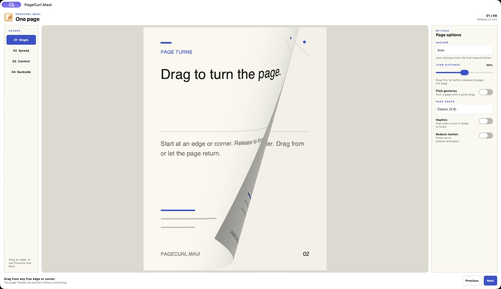

# PageCurl.Maui


Page turns for images, live MAUI views and two-page spreads. The library targets
.NET 10 and MAUI 10, with a platform-independent interaction and geometry layer.

**[Documentation](https://mariusmuntean.github.io/PageCurl-docs/)** ·
[Quick start](docs/site/getting-started.md) · [Runtime rules](docs/site/runtime.md) ·
[Platform support](docs/compatibility.md)

[](docs/site/images/pagecurl-preview.mp4)

[Watch the 20-second preview](docs/site/images/pagecurl-preview.mp4): drag and
snap-back, a spread turn, live content and a scene switch. Recorded from the
Mac Catalyst demo at normal speed.

## Choose a control

| Control | Content |
| --- | --- |
| `PageTurnView` | Caller-owned `SKImage` values |
| `PageCurlView` | A live MAUI view with a cached snapshot while turning |
| `PageSpreadView` | A two-page reader with neighboring content |

## Install

Install from your MAUI application's directory:

```bash
dotnet add package PageCurl.Maui --version 0.1.0
```

`PageCurl.Core` comes transitively with the MAUI package.
To develop against source, reference `src/PageCurl.Maui/PageCurl.Maui.csproj`
from a local checkout instead.

The guides and preview follow the current source. Constructor-setting,
spread-readiness and resize/padding fixes in the [latest review](docs/validation/holistic-review-2026-10-10/README.md)
are available in the [0.1.1 GitHub release](https://github.com/mariusmuntean/PageCurl/releases/tag/v0.1.1); NuGet publication is pending.

Register SkiaSharp in your MAUI app:

```csharp
using SkiaSharp.Views.Maui.Controls.Hosting;
builder.UseMauiApp<App>().UseSkiaSharp();
```

The [quick start](docs/site/getting-started.md) covers XAML setup and navigation;
the [small reader example](docs/site/spreads.md#small-reader-example) adds a complete
five-page book with capture readiness, retry and an odd final page;
the [API reference](https://mariusmuntean.github.io/PageCurl-docs/api-index.html)
lists public signatures.

## Try the sample

The sample has Single, Spread, Content and Backside scenes. It demonstrates
navigation boundaries, edge/corner anchors, live controls, local video,
backside choices, reduced motion and haptics.

Use the SDK and workload set pinned in `global.json`. From the repository root
on macOS:

```bash
dotnet workload install maui-ios maui-maccatalyst maui-android
dotnet build src/PageCurl.Demo/PageCurl.Demo.csproj -c Debug -f net10.0-maccatalyst
```

Open the resulting `PageCurl.Demo.app`, or select the demo's target in Rider.
Use an explicit Android, iOS, Mac Catalyst or Windows framework for platform
builds. See [platform notes](docs/platform-notes.md) for native prerequisites,
iPhone provisioning and host-specific troubleshooting.

## Development

- Core contains interaction, navigation and fixed-buffer page geometry.
- MAUI contains rendering, snapshots, threading and device adapters.
- Demo contains the showcase, media and page model.

Read [requirements](docs/requirements.md) and [testing](docs/testing.md) before
changing behavior. The Verify workflow covers deterministic tests, isolated
package consumption, package contents and platform builds. Native assertions
and real-input journeys have separate [validation records](docs/index.md).

Build the documentation with `bash tools/build-docs.sh`; publish the validated
site with `bash tools/publish-docs.sh`. See the [documentation guide](docs/documentation.md).

The 0.x API may change before 1.0. Hardware performance, screen-reader passes,
Windows runtime behavior and signing remain
[release gates](docs/release-readiness.md). Build coverage alone does not close them.

[MIT license](LICENSE) · [Support and issue reporting](SUPPORT.md) ·
[Contributing](CONTRIBUTING.md) · [Security reporting](SECURITY.md) ·
[Third-party media notices](THIRD-PARTY-NOTICES.md)
